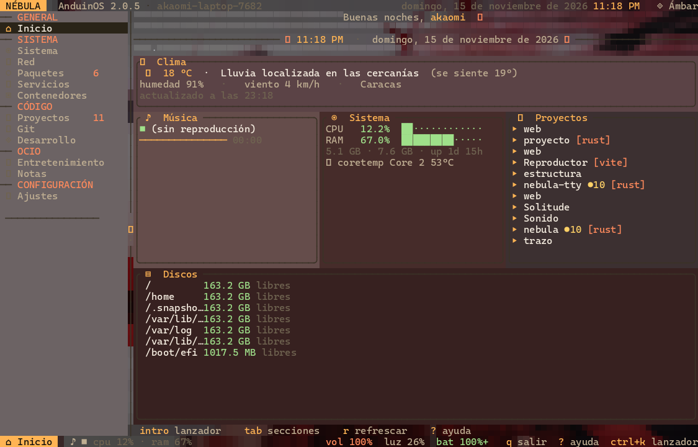
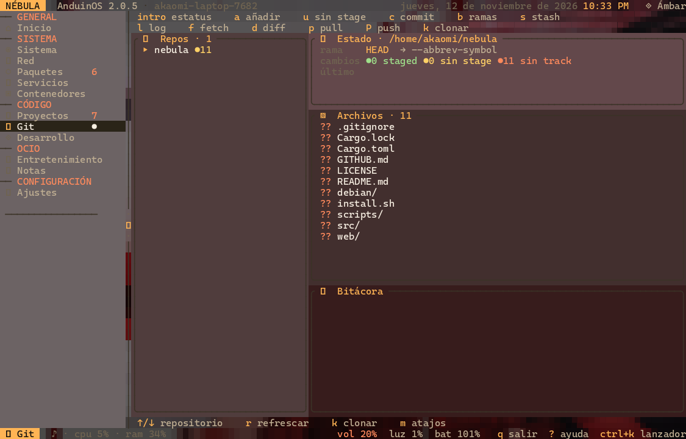
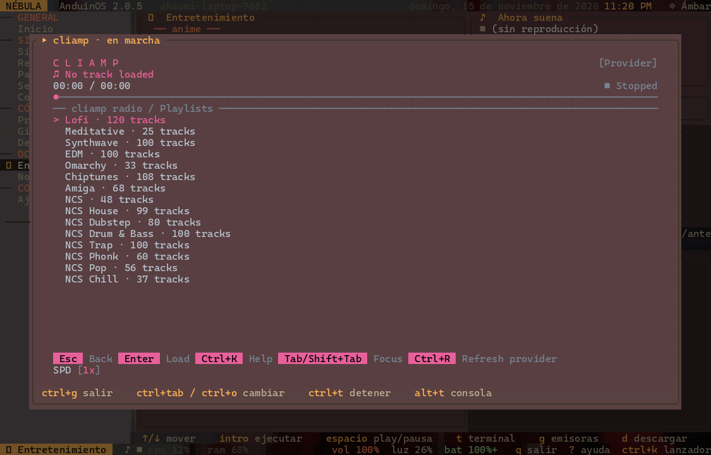
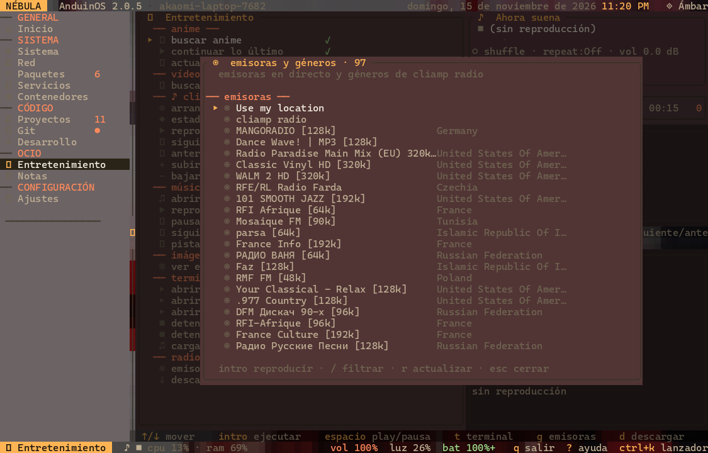
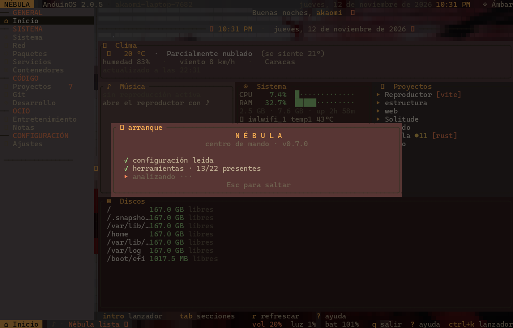
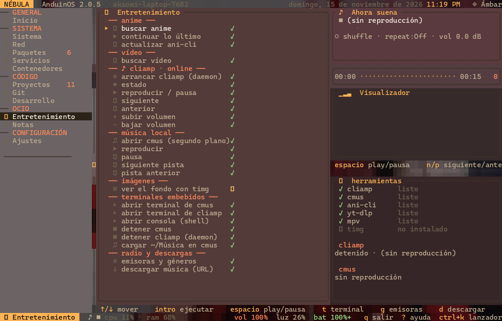
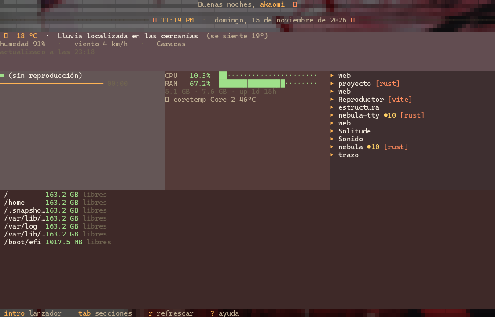

# ✦ Nébula

[](LICENSE)
[](https://www.rust-lang.org)
[](https://github.com/L3IB0R/nebula/actions/workflows/ci.yml)
[](https://github.com/L3IB0R/nebula/releases/latest)
[](https://nebula-tui.surge.sh)

**Un segundo escritorio visual para tu terminal.**
Nébula es una TUI en Rust pensada para Debian/Ubuntu: no es una consola de
hacker, es un panel de cristal esmerilado donde viven tu reloj, tu música,
tus proyectos y tu sistema — con tu fondo de pantalla real detrás.

```
┌──────────────────────────────────────────────────────────────────┐
│ NÉBULA   AnduinOS · akaomi      sábado, 7 de noviembre  ◈ Aurora │
│ ── GENERAL         ╭ ★ Entretenimiento ─╮  ╭ ❖ Proyectos ───────╮│
│ ⌂ Inicio           │▶ Loving You        │  │▸ nebula     [rust] ││
│ ── SISTEMA         │  Sade · 4:12       │  │▸ Reproductor [vite]││
│ ◉ Sistema          │  ▁▂▄▆█▅▃▂▄▇█▆▄▂    │  │▸ estructura        ││
│ ⇄ Red              │  espacio play/pausa│  │▸ Solitude          ││
│ ⬡ Paquetes         │  ♪ cliamp · online │  │▸ Sonido            ││
│ ⚙ Servicios        │                    │  │                    ││
│ ▣ Contenedores     ╰────────────────────╯  ╰────────────────────╯│
│ ── CÓDIGO          ╭ ◉ Sistema ─────────╮  ╭ ⇄ Red ─────────────╮│
│ ❖ Proyectos        │CPU   7.1% ██·······│  │↓1.2 MB/s  ↑84 KB/s ││
│ ⎇ Git              │RAM  35.9% ██████···│  │wlo1 · ethernet     ││
│ ◈ Desarrollo       │2.7 GB · 7.6 GB     │  │escuchando · 8      ││
│ ── OCIO            │🌡 iwlwifi_1 36 °C   │  │▸ ssh   :22         ││
│ ★ Entretenimiento  │kernel 7.0.0-42     │  │▸ http  :443        ││
│ ✎ Notas            │                    │  │                    ││
│ ── CONFIGURACIÓN   ╰────────────────────╯  ╰────────────────────╯│
│ ☾ Ajustes                                                        │
└──────────────────────────────────────────────────────────────────┘
```

## La idea

Empecé este proyecto por una razón que con el tiempo se transformó en otra.
Al principio sólo quería algo **visual y personalizado en Linux**: un segundo
escritorio, bonito, **sin tocar el escritorio ni estar haciendo mucha
configuración**, y **sin gastar recursos**. Algo al estilo de quien se instala
`neofetch` para tener algo bonito más que util — pura estética con un punto
de utilidad.

Pues esto viene a ser eso… sólo que al final le fui agregando cosas.

## Qué hace

| Módulo | Contenido |
| --- | --- |
| **Inicio** | Reloj con **cinco estilos** (digital, línea, tablero, analógico, mínimo) y cinco tamaños, saludo, **clima en vivo** y widgets a tu medida |
| **Sistema** | CPU con histórico, núcleos en vivo, memoria, discos, temperaturas, kernel/GPU y procesos con **micro-barras por fila**, realce del que más come y filtros (`f` cpu >1% · míos, `/` por nombre, `k` matar) |
| **Proyectos** | Escanea `~`, `~/Documentos`, `~/Proyectos`… detecta React, Vite, Rust, Prisma, Python |
| **Git** | **Tira de dos filas con todo a la vista**: estatus, `a` añadir (casilla por ruta), `u` sin stage, `c` commit, `b` ramas, `s` stash, `l` log, `f` fetch, `d` diff, `p`/`P` pull/push y `k` clonar por URL |
| **Desarrollo** | Bases de datos PostgreSQL: esquema, tablas y prueba de conexión |
| **Red** | Bajada/subida en vivo con histórico, dispositivos, `nmcli`, puertos `ss` con **filtros** (`f` escuchando · establecidas, `/` puerto o nombre) y ping |
| **Contenedores** | Docker/Podman: imágenes, contenedores, arranque/parada/borrado con confirmación |
| **Paquetes** | `apt` actualizables, `flatpak` y `snap` con actualización segura, **panel «Operaciones apt» siempre visible** (`m` lo enfoca) e **instalación escrita aquí dentro** (`i`) |
| **Servicios** | `systemctl` completo con filtro, arranque/parada y recarga; el estado se lee en el visor interno |
| **Notas** | Bloc dentro de Nébula: leer con las flechas, `i` para editar, `Ctrl+S` para guardar |
| **Ajustes** | Ocho categorías —Temas, Apariencia, Reloj, Widgets, **Clima**, Sistema, **Recursos** y **Terminal**— con controles visibles |
| **Entretenimiento** | Anime y vídeo **buscados dentro de Nébula** (AniList · `yt-dlp`), imágenes (`timg`), **terminales embebidos de cmus y cliamp** y la **consola embebida** (`Alt+T`), el menú de **emisoras y géneros**, el **descargador de música por URL** y **el reproductor embebido**: `espacio` play/pausa, `m` menú de música y grupo `♪ cliamp · online` |

Los detalles de cada fase —y del mantenimiento de v0.7.0— están en el
[CHANGELOG](CHANGELOG.md). Lo que se nota al usarlo:

- **Visor interno**: git, `apt`, `systemctl` y los reproductores corren en un
  hilo y su salida se pinta **línea a línea dentro de Nébula**, con `Esc` para
  cerrarlo sin matar el comando — no se abre otra terminal salvo que lo pidas.
- **Widgets de Inicio** a tu medida (clima, música, sistema, proyectos, red,
  discos y mundo): `espacio` los muestra u oculta y `f` cambia su forma.
- **Modo zen** (`F11`): sólo el contenido, sin cromo, sin bordes, sin títulos.
- **Barra de estado** con chips vivos de volumen (`wpctl`), brillo y batería,
  y el chip `♪` que alterna play/pausa desde cualquier pestaña.
- **Pantalla de bienvenida** que analiza tu sistema al arrancar y se retira
  sola (`Esc` la salta); la barra lateral se abre y cierra con `Ctrl+B`.
- **Salida limpia**: `SIGTERM`/`SIGHUP`/`SIGQUIT`/`SIGINT` restauran la
  terminal y salen con código 0, sin dejar la consola en crudo ni el cursor
  escondido.
- **Instalador** que crea `~/Música/Nébula` para las descargas (respeta
  `XDG_MUSIC_DIR`).

## Instalación

```bash
./install.sh            # compila en release e instala en ~/.local/bin
./install.sh --dev      # sólo compila (cargo build)
./install.sh --system   # instala en /usr/local/bin (pide sudo)
```

O con `cargo-deb`:

```bash
cargo install cargo-deb
cargo deb               # genera target/release/nebula_0.7.0-1_amd64.deb
sudo dpkg -i target/release/nebula_*.deb
```

Ejecuta `nebula` en cualquier terminal (mínimo 80×24, ideal 120×40).

## Atajos

| Tecla | Acción |
| --- | --- |
| `Ctrl+K`, `espacio`, `Ctrl+P` | Abrir el lanzador (apps, comandos, carpetas, proyectos) |
| `Tab` / `Shift+Tab` | Siguiente / anterior módulo |
| `1`–`9`, `0` | Ir directo a un módulo |
| `f` | Filtro del módulo (Sistema, Red, Servicios, Proyectos…) |
| `/` | Buscar por nombre o puerto en la lista activa |
| `?`, `F1` | Ayuda de atajos |
| `F2` | Ajustes (categorías con `←/→`, opciones con `↑/↓`, `espacio` cambia) |
| `↑ ↓ ← →` | Navegar dentro del módulo |
| `Ctrl+B`, ratón en `⟨/⟩` | Colapsar / abrir la barra lateral (queda sólo iconos) |
| `Ctrl+E` | Enfocar la barra lateral: `↑/↓` elegir pestaña (saltan las cabeceras), `Intro` entrar, `Esc` salir |
| `a` `u` `c` `k` | En Git: añadir por ruta, quitar del stage, commit y clonar por URL |
| `m` | Menú local de cada módulo —en Paquetes **enfoca el panel apt**, en Git abre los atajos— |
| `t` | **Terminal embebido**: `cmus` o `cliamp` dentro de un panel, con sus propias teclas |
| `Alt+T` | **Consola embebida**: el shell de login (`$SHELL -l`) dentro del panel, desde cualquier pestaña |
| `g` | **Emisoras y géneros** de cliamp, con filtro (`/`) y actualización (`r`) |
| `d` | **Descargar música** de YouTube por URL (`yt-dlp`, mp3/m4a/opus) |
| `Ctrl+G` | Salir del panel del terminal (el proceso sigue vivo) |
| `Ctrl+Tab` / `Ctrl+O` | Cambiar de aplicación dentro del terminal (cmus ↔ cliamp ↔ consola) |
| `Ctrl+T` | Detener el proceso del terminal que está en pantalla |
| `Esc` en el visor | Cierra la salida; el comando sigue y su resultado llega como aviso |
| `F11` | Modo zen: sin cromo, sin bordes, sin títulos |
| `Ctrl+↑` / `Ctrl+↓` | Volumen +5% / −5% |
| `Ctrl+Mayús+↑` / `↓` | Brillo +5% / −5% |
| `Ctrl+espacio` | Silenciar / devolver el sonido |
| `q` | Salir (en Notas, primero sale del modo edición) |
| `SIGTERM` / `SIGHUP` | **Salida limpia**: Nébula restaura el terminal y sale con código 0 (otra señal seguida lo fuerza ya) |
| `Esc` | Cerrar superposiciones · saltar la pantalla de arranque |
| Ratón | Clic en la barra lateral, rueda para desplazar, **clic en el chip `♪`** = play/pausa |

## Temas

Seis paletas: **Aurora** (por defecto), **Cobalto**, **Ámbar**, **Sepia**,
**Bosque** y **Orquídea**. Se cambian desde *Ajustes → Temas* con una
transición interpolada, sin parpadeos.

## Línea de comandos

```bash
nebula --help              # ayuda
nebula --version           # versión
nebula --themes            # lista las paletas disponibles
nebula --theme Orquídea     # arranca con ese tema (queda guardado)
nebula --config            # ruta del config.toml
```

## Fondo de pantalla

Nébula dibuja tu wallpaper real en la terminal con semibloques `▀`
(fg = píxel superior, bg = inferior), así que funciona en cualquier terminal
truecolor. Modos: `image` (tu fondo actual), `transparent` (solo estrellas y
paneles) y `solid` (color del tema). Detecta `~/.config/background`,
`~/.config/nebula/wallpaper` y los habituales de GNOME/KDE.

Los paneles mezclan su color con el wallpaper que tienen debajo: efecto
cristal esmerilado. Puedes pasarlos a `solid` en *Ajustes → Apariencia*.

## Configuración

`~/.config/nebula/config.toml`:

```toml
[general]
theme = "Aurora"
name = "akaomi"
clock_24h = true
show_seconds = true
clock_size = "auto"       # auto | bar | small | medium | large
clock_style = "digital"   # digital | linea | flip | reloj | minimal
sidebar = true            # ¿arrancar con la barra lateral abierta?

[home]                    # widgets de Inicio: presencia, orden y forma
widgets = ["clima", "musica", "sistema", "proyectos", "red"]
styles = { sistema = "completo", red = "grafico", disco = "barras" }

[appearance]
background = "image"      # image | transparent | solid
wallpaper = ""            # vacío = autodetectar
wallpaper_opacity = 0.55
vignette = true
stars = true
panel = "glass"           # glass | solid
animations = true
pywal = false             # true = acentos desde ~/.cache/wal/colors.json

[keys]                     # atajos personalizables
launcher = "ctrl+k"
help = "?"
zen = "f11"
sidebar = "ctrl+b"
sidebar_focus = "ctrl+e"    # enfocar la lateral
mute = "ctrl+space"

[weather]                   # lugar del widget de clima (wttr.in)
place = ""                  # escrito a mano: "Madrid", "Carrizal,VE"…
country = ""                # o por catálogo: código ISO ("ES", "VE"…)
city = ""                   # ciudad de ese país

[projects]
dirs = ["~", "~/Documentos", "~/Proyectos", "~/Escritorio"]
editor = "gnome-text-editor"
max = 120
```

## Dependencias del sistema (opcionales)

Nébula funciona sin nada de esto, pero cada cosa que falte se avisa en su
panel con el comando de instalación exacto:

```bash
sudo apt install git cmus            # módulo Git y música offline
sudo apt install brightnessctl       # brillo suave (si no, se usa sysfs con pkexec)
sudo apt install zoxide              # carpetas frecuentes primero en el lanzador
sudo apt install ani-cli mpv fzf     # anime desde Entretenimiento (se ofrece ahí mismo)
sudo apt install yt-dlp ffmpeg mpv  # descargas y búsqueda de vídeo
# cliamp        → se instala desde el menú de música (m en Entretenimiento)
# curl          → tarjeta de clima (wttr.in) y búsqueda de anime (AniList)
# docker/podman, flatpak, snap, nmcli, ss, pywal, timg
```

Todo eso (y más) está en **Ajustes → Recursos**, con el estado en vivo y dos
botones: instalar la sección que tengas seleccionada o instalar todo lo que
falte con una sola contraseña.

## Capturas y pruebas

```bash
python3 scripts/smoke.py    # recorre los 12 módulos en un pty y no debe fallar
python3 scripts/fase2.py    # zen, lateral, volumen, silencio y clima
python3 scripts/fase3.py    # reloj, ajustes (8 categorías), widgets y recursos
python3 scripts/fase4.py    # arranque, Ctrl+E, clima, entretenimiento y menús
python3 scripts/fase5.py    # visor interno, commit, búsqueda de anime y reproductores
python3 scripts/fase6.py    # lateral por secciones, pies de atajos, tira de git y chip ♪
python3 scripts/fase7.py    # terminales embebidos, emisoras, descargas, brillo y TTY
python3 scripts/mant.py     # señales (SIGTERM), consola embebida y siembra de cmus
python3 scripts/shots.py    # regenera web/shots/*.png para la web
NEBULA_RAW=1 python3 scripts/fase6.py   # además guarda la salida cruda (ptys)
cargo fmt --check           # formato
cargo clippy                # 0 avisos
```

## Capturas















## Hecho con

[Ratatui](https://ratatui.rs) · [crossterm](https://github.com/crossterm-rs/crossterm) ·
[sysinfo](https://docs.rs/sysinfo) · [postgres](https://crates.io/crates/postgres) ·
[image](https://crates.io/crates/image)

Licencia MIT.
